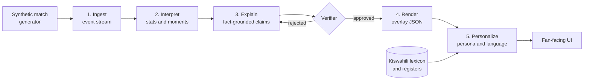

# Mechi Yako

> **One match, told your way, in your language.**

Mechi Yako ("your match" in Kiswahili) turns a live stream of football events into explainable insight for each fan, written **natively in Kiswahili**, not translated from English after the fact.

Built for the Microsoft Premier League Hackathon ("Inside the Game"). All data is **synthetic**. All clubs and players are **fictional**.

**Live demo:** https://mechi-yako.icyriver-d1adadda.southafricanorth.azurecontainerapps.io/  
**Health:** https://mechi-yako.icyriver-d1adadda.southafricanorth.azurecontainerapps.io/health  
**Demo video:** _coming soon_ (under 2 minutes; see [`docs/demo-storyboard.md`](docs/demo-storyboard.md))

---

## For judges

The live app is one container: FastAPI + the Vite build, same origin.

1. Open the [live demo](https://mechi-yako.icyriver-d1adadda.southafricanorth.azurecontainerapps.io/).
2. Click **Join at 55′**. The feed is already 1–0; the press, shot, and equaliser stream in.
3. Select the **pressure spell**, then switch persona **Analyst → Newcomer**.
4. Select the **63′ goal**, toggle **English → Kiswahili**, then switch register.
5. In **Why?**, the strip is Detect → Explain → Verify → Personalize. Open **Broadcast overlay JSON**.
6. Optional: `GET /docs` and `POST /matches/m-demo-001/claims/check` with `"value": 99` — the verifier returns `"status": "blocked"`.

If the API is slow to warm, wait until `/health` shows `explainer.warm.running: false`. Cached fallback: add `?demo=cached` to the URL.

---

## The problem

1. **Broadcasts show what happened, not why it mattered.** A viewer sees a turnover and a shot. They don't see that it was the third time in five minutes the defence had been caught high.
2. **One broadcast serves everyone, so it serves no one well.** An analyst wants pressing numbers. A casual fan wants the story. A newcomer needs the terms explained.
3. **Most AI football tooling is English-first.** Machine-translated commentary is stiff, loses football idiom and mistranslates tactical terms. Millions of fans follow the game in Kiswahili, but the tooling around them rarely speaks it naturally.

## The solution

Mechi Yako sits on one shared layer of **verified facts** and renders it differently for every viewer:

- **One match, many matches.** The same moment is explained for an analyst, a casual fan, or a newcomer. The facts never change. The depth, vocabulary and focus do.
- **Kiswahili-first.** Narratives are generated directly in Kiswahili using a curated football lexicon and selectable registers (formal broadcast, casual banter, simple explainer).
- **Explainable by design.** Every on-screen claim cites the event IDs that support it, and a verifier blocks anything it cannot reproduce from the raw events.

### Same moment, three viewers

> Illustrative example using fictional clubs. The lines the app actually shows are listed in [`docs/demo-storyboard.md`](docs/demo-storyboard.md#exact-on-screen-lines-from-the-deterministic-writers).

| Viewer | Output |
|---|---|
| **Analyst** (English) | 62' Blue Herons have lost possession four times in their own half in five minutes. Red Kites' press is forcing errors, with 7 high turnovers in the last 10 minutes. |
| **Casual fan** (English) | Blue Herons keep giving the ball away near their own goal, and Red Kites can smell a chance. |
| **Casual fan** (Kiswahili) | Dakika ya 62: Blue Herons wamepoteza mpira mara nne karibu na lango lao ndani ya dakika tano. Red Kites wanawabana vilivyo! |

Each line carries the event IDs it is based on, such as `e-0412`, `e-0415`, `e-0419`.

---

## How it works

Mechi Yako follows the five-stage pipeline in the hackathon brief.



1. **Ingest.** Synthetic events (passes, shots, tackles, possession changes, pressure) arrive on a stream with match metadata.
2. **Interpret.** Events are aggregated into match state and statistics, and a significance scorer picks out the moments that matter.
3. **Explain.** An explainer writes *why* each moment matters as structured claims, each tied to event IDs.
4. **Render.** Verified output is emitted as timed overlay JSON (`GET /matches/{id}/moments/{moment_id}/overlay`) that a graphics layer can place alongside a live feed. The UI lower third consumes the same shape.
5. **Personalize.** A persona writer rewrites the same verified facts for the chosen expertise level, language and register.

### Agents

Specialized roles, one chain. Numbers never come from a model.

| Agent | Role | What actually runs |
|---|---|---|
| **Moment Detector** | Scores events and picks the moments worth explaining | Deterministic (`pipeline/moments.py`) |
| **Explainer** | Writes grounded, claim-structured explanations | Template facts; Microsoft Foundry `gpt-5-mini` may rewrite the *why* sentence |
| **Verifier** | Recomputes every claim from raw events; approves, corrects or blocks | Deterministic (`agents/verifier.py`) — never an LLM |
| **Persona Writer** | Renders verified facts for analyst, casual fan, or newcomer | Deterministic templates |
| **Kiswahili Narrator** | Composes the narrative natively from facts + lexicon | Deterministic templates |
| **Language QA** | Checks numbers, names, event IDs and lexicon terms | Deterministic rules |

Foundry is optional. If the call times out or the number-guard rejects a rewrite, the template sentence is kept. The Why? panel shows which explainer produced the line.

---

## Kiswahili-first, not translate-after

Most pipelines write in English and translate. Mechi Yako generates in the target language from structured facts.

- **Football lexicon.** [`lexicon/sw.yaml`](lexicon/sw.yaml) holds 50 demo-match terms. Each has the English and Kiswahili forms, inflected forms for matching, and a one-line gloss in both languages. It also maps each moment type to the terms its narrative must use (a goal must say *bao*, a press must say *kubana* and *kunyang'anya mpira*).
- **Registers.** Formal broadcast (*Dakika ya 63, Omar Diallo anafunga bao la kusawazisha…*), casual banter (*Goooli! Omar Diallo anatikisa nyavu…*), and simple explainer for newcomers. The lexicon carries a short style guide and sample lines per register.
- **Native composition.** [`agents/narrator/sw.py`](agents/narrator/sw.py) builds each sentence from the verified facts with Kiswahili templates. It never sees the English text. Small counts are written as words (*mara tano*), the way a commentator would say them.
- **Quality loop.** [Language QA](#language-qa-rule) checks every Kiswahili line against the same facts as the English one, including Kiswahili number words and English words leaking into the text.
- **Native review: approved.** Eric Amenya and Daniel Githumbi, both native Kiswahili speakers, reviewed and approved every lexicon term, gloss, register guide and sample line, and the generated demo lines, on 20 Oct 2026. The lexicon records this under `review`. New or changed terms and templates go back to `review: pending` until a native speaker signs them off.

### Personas and languages

The persona changes depth and vocabulary. The facts stay the same.

| Persona | Default register | Keeps | Adds |
|---|---|---|---|
| **Analyst** | Formal broadcast | Counts, time windows, scorer and minute | A stats sentence built from the verified numbers |
| **Casual fan** | Casual banter | The story and the score | Nothing extra; raw counts are dropped |
| **Newcomer** | Simple explainer | The story in plain words | A one-line gloss of the key term from the lexicon |

Any persona can use any register. **Persona default** in the UI picks the register in the table. English and Kiswahili share one fact-composition step, so both languages always state the same numbers, names and event IDs.

### Language QA rule

A narrative gets **QA pass** only if all of these hold. Otherwise it gets **QA flag** with the reasons shown under the text.

1. Every number in the text, in digits or as a word (*five*, *tano*), matches a verified stat, the score, or a moment minute.
2. Every value in `stats_used` equals the verified moment stat.
3. The narrative cites at least one event, and every cited event ID belongs to the moment.
4. Every player ID in `entities_used` is one the moment references.
5. The text uses every lexicon term required for that moment type.
6. Kiswahili text contains no English function words (*the*, *and*, *with*…).

Before writing, the narration endpoint runs the claim checker on the moment. Corrected values are used in the text, and blocked stats are never written.

---

## Synthetic data

No real match data, footage, club names or player names are used.

The **Synthetic Match Factory** (`generator/`) produces football-realistic matches:

- Fictional clubs and players, with tactical profiles (for example high press or counter-attack).
- Possession-based simulation shaped by fatigue, momentum and score state.
- Seeded runs, so every match is reproducible.
- A **realism report** that checks each match against plausible ranges, such as pass completion, shots per match and possession spread.

Demo storyline (Blue Herons vs Red Kites):

1. Blue Herons lead **1–0** at half time (~20′ goal).
2. Red Kites **press** from ~**55′** and force turnovers in the Blue Herons half.
3. Red Kites **equalise** ~**63′**.
4. **RK-4** hits a **5th tackle won** milestone ~**78′**.

Example event:

```json
{
  "id": "e-0415",
  "t": "62:14",
  "type": "tackle",
  "team": "RK",
  "player": "RK-4",
  "location": [68, 40],
  "outcome": "won_possession",
  "match_id": "m-0007"
}
```

The full schema is documented in [`docs/event-schema.md`](docs/event-schema.md).

---

## Trust and explainability

AI commentary is only useful on screen if it is right. Mechi Yako uses a **claim-then-verify** design:

1. The explainer emits text plus structured claims (metric, value, entities, event IDs).
2. The verifier recomputes each claim deterministically from the raw events.
3. Claims are approved, auto-corrected or blocked, and every decision is logged for audit.
4. Every persona and language version is checked against the same fact layer, so versions cannot drift apart.

The audit log is in memory for this demo (it resets on restart). That is enough to show a blocked wrong-stat in `/audit`; it is not a durable store.

---

## What we actually run

| Layer | In this submission |
|---|---|
| Models | Microsoft Foundry, `gpt-5-mini`, Responses API — optional Why-sentence rewrite |
| Compute | Azure Container Apps (`mechi-yako`, South Africa North) |
| Registry | Azure Container Registry (`mechiyakoacr`) |
| CI/CD | GitHub Actions: pytest + typecheck + image build on PR; push to ACR and `az containerapp update` on `main` |
| API | FastAPI + uvicorn, SSE live feed |
| Front end | React + TypeScript (Vite), served from the same image |
| Local stream | In-process queue (`pipeline/queue.py`) |
| Dev tooling | GitHub Copilot Agent Mode |

We do **not** use Cosmos DB, Event Hubs, Fabric, Speech, or Microsoft Agent Framework in this build. Listing them as "planned" would overclaim.

Infra notes and the public URL: [`infra/README.md`](infra/README.md).

---

## Getting started

Python 3.10+, Node 18+. Or Docker Desktop.

```bash
git clone https://github.com/posh9376/mechi-yako.git
cd mechi-yako

# One container (API + UI on :8080). Copy .env.example → .env first if you want Foundry.
docker compose up --build
```

Without Docker:

```bash
python -m generator.build_demo_data
python -m pipeline.replay --instant
python -m pipeline.detect
python -m agents.run_explain_verify

pip install -r requirements-dev.txt
python -m uvicorn api.main:app --reload --port 8000

cd web && npm install && npm run dev
```

Optional Foundry: copy `.env.example` to `.env` and set `MECHI_EXPLAINER=foundry` plus the Azure OpenAI endpoint, key, and `gpt-5-mini` deployment. The template explainer still runs without this.

```bash
pytest
python -m api.build_cache --check
```

### Web app modes

| How you open it | Data source |
|---|---|
| `npm run dev` with no `VITE_API_BASE_URL` | **Fixtures.** Match JSON and fixture moments are bundled into the app. Narrations come from the cached bundle. No backend needed. |
| `VITE_API_BASE_URL=http://127.0.0.1:8000 npm run dev` | **API, Live.** Opens on the server's SSE feed. **Go live** streams from kick-off and **Join at 55′** starts at the press. Pause, Resume, Restart and Speed reopen the stream. A **Live / Replay** toggle switches to the scrubbable replay of the same 7 live moments, starting at the current clock. Narration comes from live `/narrate` calls. Copy `web/.env.example` to `web/.env.local` to make this permanent. |
| API mode plus `?moments=fixture` | API replay, pinned to the five fixture moments. No Live toggle. |
| `?demo=cached` | **Cached demo.** Reads `web/public/demo-bundle.json` and makes no API calls. Used when the API is down. |

In Live mode the browser fetches only match metadata up front. Events, score and moments arrive solely through `/feed`, so the screen shows exactly what the server has streamed so far. Resume reconnects from the last event received. The server's `snapshot` frame then replaces the lists, so nothing is duplicated or skipped. If the stream drops, the status pill shows **Disconnected** with **Retry** and **Switch to replay**.

If the API is unreachable at load, the error panel offers **Try again** and **Use cached demo**. The header always shows which source is active.

The API reads `MECHI_CORS_ORIGINS` (comma-separated) for allowed origins. The default allows the Vite dev server on `localhost` and `127.0.0.1` port 5173.

### API

All match routes take `match_id` (`m-demo-001` today). Moment routes take `source=live` (default; `MomentDetector.detect_all`) or `source=fixture` (the fact-layer fixture). The two sources use different moment IDs.

| Method | Route | Returns |
|---|---|---|
| GET | `/health` | `status`, loaded `match_id`, `schema_version`, event count, fixture and live moment counts, and `explainer` (mode, active explainer, `cached` count, `warm` progress) |
| GET | `/matches` | Available match IDs |
| GET | `/matches/{id}` | Match metadata, `schema_version`, event count |
| GET | `/matches/{id}/events?start=55:00&end=65:00` | Events in a clock window (inclusive) |
| GET | `/matches/{id}/state?at=63:00` | Aggregated match state up to a clock, or full time |
| GET | `/matches/{id}/moments?source=live` | Detected moments with `event_ids` and `stats` |
| GET | `/matches/{id}/moments/{moment_id}/overlay?source=live` | Timed overlay JSON: clock, score, text, event IDs, agent chain |
| GET | `/matches/{id}/feed?speed=120&instant=false&start=&end=` | SSE stream. First a `snapshot` frame (`clock`, `score`, and the `events` and `moments` before `start`), then one `match_event` per event (`event`, `clock`, `score`), `moment` frames as the online detector fires, and a final `done`. Moment IDs match `/moments?source=live`. |
| GET | `/personas` | Personas, languages, registers per language, lexicon version and review status |
| POST | `/matches/{id}/narrate` | `{moment_id, persona, language, register?, source?, explain?}` → narrative, QA result, verification summary, and the explanation package unless `explain` is `false` |
| GET | `/matches/{id}/moments/{moment_id}/explain?source=fixture` | Explanation package for one moment: why-it-matters sentence, claims with evidence, `explainer` used |
| GET | `/matches/{id}/claims?source=live` | Every moment stat as a verified claim, plus a summary |
| POST | `/matches/{id}/claims/check` | `{moment_id, metric, value, event_ids?, source?}` → approved, corrected or blocked; written to the audit log |
| GET | `/matches/{id}/audit` | Audit log entries for the match (in memory, reset on restart) |

Unknown match or moment IDs return 404. Malformed clocks and invalid persona, language or register values return 422.

#### Foundry explainer latency

With `MECHI_EXPLAINER=foundry`, the web app keeps narration and explanation on separate requests. It calls `/narrate` with `explain: false`, so the narration renders straight away. It then fetches `/explain` for the Why? panel, which shows the verified stats while the sentence loads.

- **One call per moment.** Explanations depend only on the moment, so the API caches them by match, source, moment content, model and prompt version. Persona, language and register switches reuse the cached package. Concurrent requests for the same moment share one Foundry call.
- **Pre-warm.** At startup the API explains every live and fixture moment in the background, three at a time. `/health` reports progress under `explainer.warm`. The cache persists to `.cache/explanations.json`, so a restart serves explanations immediately.
- **Bounded calls.** Each call uses minimal reasoning effort, no SDK retries and an overall deadline (`MECHI_FOUNDRY_TIMEOUT_S`, default 10 s). On a timeout or error the template sentence is served and the Why? panel says so. After an error the API uses the template for 30 seconds before trying Foundry again. Failed explanations are never cached.
- **Number guard.** A rewritten sentence may only use numbers present in the moment's stats, clocks, headline or template sentence. Otherwise the template sentence is kept and the claim is listed in `foundry_rejected`.

Measured on `gpt-5-mini`: a cold explanation takes about 2–3 s (about 5 s for the first call while the connection opens). Once cached, `/explain` and `/narrate` return in a few milliseconds. The tuning variables are listed in [`.env.example`](.env.example).

Example:

```bash
curl -s -X POST http://127.0.0.1:8000/matches/m-demo-001/narrate \
  -H 'content-type: application/json' \
  -d '{"moment_id": "mom-goal-equaliser-01", "persona": "casual", "language": "sw", "source": "fixture"}'

curl -s "http://127.0.0.1:8000/matches/m-demo-001/moments/mom-goal-equaliser-01/overlay?source=fixture"
```

### Project structure

```
mechi-yako/
├── data/           # Demo match JSON + fact-layer fixtures
├── docs/           # Event schema, claim schema, cache bundle, storyboard
├── generator/      # Scripted demo match builder + realism report
├── pipeline/       # Replay, state aggregator, moment detector
├── agents/         # Explainer, verifier, persona, narrator, language QA
├── lexicon/        # Kiswahili lexicon (sw.yaml)
├── api/            # FastAPI, claims, overlay JSON, SSE feed
├── web/            # Vite + React match view, Why? panel, lower third
├── infra/          # Azure Container Apps notes
└── tests/          # Backend tests
```

Owner split while building: [`TEAM_TASKS.md`](TEAM_TASKS.md).

---

## Status

- [x] Event schema, synthetic demo match, realism report
- [x] Replay, match-state aggregator, moment detector
- [x] Claim schema, template explainer, deterministic verifier
- [x] Fact-layer HTTP API with SSE live feed
- [x] Personas, Kiswahili narrator, language QA, native-speaker review (20 Oct)
- [x] Front end with persona, language and register switches
- [x] Why? panel, lower third, overlay JSON
- [x] Foundry-backed explainer (template fallback; numbers stay verified)
- [x] Docker image, GitHub Actions CI/CD, Azure Container Apps demo
- [ ] Demo video ([storyboard](docs/demo-storyboard.md))

---

## Hackathon fit

| Hackathon requirement | Where Mechi Yako addresses it |
|---|---|
| Ingest, interpret, explain, render, personalize | The five-stage pipeline above |
| Explainability | Fact-grounded claims with event-ID citations and a verifier |
| Multi-language storytelling | Kiswahili-first native generation |
| Personalized experiences | Persona engine for analysts, casual fans and newcomers |
| Data innovation | Synthetic Match Factory with a realism report |
| Responsible, enterprise-ready AI | Verification, audit logging, fairness checks across versions |

Category we are entering: **Best Azure Cloud Native Integration** (Container Apps, ACR, GitHub Actions). The enterprise story is claim-then-verify, not a full data platform.

---

## Responsible AI and data notes

- All data is synthetic. Clubs and players are fictional and no real marks or likenesses are used.
- Generated claims are verified against source events before display.
- Personas change framing and depth, never facts.
- This project is not affiliated with or endorsed by any league, club or broadcaster.

## Known limitations

- Kiswahili coverage is limited to the 50 demo-match terms and three registers reviewed so far. Other languages and dialects are future work.
- Narration is template-based. Lines are accurate and consistent but less varied than model output.
- Foundry only rewrites the Why sentence. Detector, verifier, persona writer, narrator and QA are deterministic code behind stable interfaces.
- The audit log is in memory and resets when the API restarts.
- Player-focus mode and a full-match recap are not in this build.
- Synthetic matches approximate real football. They are not a statistical model of any real league.

## Roadmap

- More languages (Sheng, Arabic, Hindi) with native lexicons
- Audio narration in Kiswahili
- Player-focus mode
- Accessibility mode with audio description

## License

MIT. See [`LICENSE`](LICENSE).

## Team

- **Daniel Githumbi** — data, pipeline, explainer/verifier, infra/deploy; Why? panel / overlay.
- **Eric "Posh" Amenya**, Nairobi, Kenya — API, backend tests, personas, Kiswahili, demo video; match view / switches. Representative / submitter (default).
