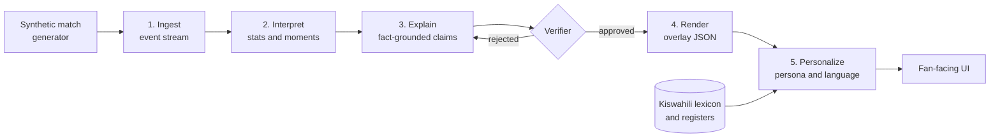

# Mechi Yako

> **One match, told your way, in your language.**

Mechi Yako ("your match" in Kiswahili) is an AI match-intelligence system. It takes a live stream of football match events and turns it into explainable insight that is personalized for each fan, and written **natively in Kiswahili**, not translated from English after the fact.

Built for the Microsoft Premier League Hackathon ("Inside the Game"). All data is **synthetic**, and all clubs and players are **fictional**.

<!-- TODO: add demo video link (under 2 minutes) -->
**Demo video:** _coming soon_ | **Live demo:** _coming soon_

---

## Current progress (handoff for Eric / Posh)

Owner split: see [`TEAM_TASKS.md`](TEAM_TASKS.md).  
Working branch for combined API + verifier: **`feature/posh-api-foundation`** (includes Daniel explain/verify from `main`).

### What Daniel shipped

| When | Piece | Where |
|---|---|---|
| Oct 17 | Event schema, demo match, fixtures, realism | `docs/`, `data/`, `generator/` |
| Oct 17 | Replay, state aggregator, moment detector | `pipeline/` |
| Oct 18 | **Claim schema** | [`docs/claim-schema.md`](docs/claim-schema.md) |
| Oct 18 | **Template explainer** (no Foundry yet) | [`agents/explainer.py`](agents/explainer.py) |
| Oct 18 | **Deterministic verifier** + audit log | [`agents/verifier.py`](agents/verifier.py) |
| Oct 18 | Explain→verify CLI + **injected wrong-stat** demo | `python -m agents.run_explain_verify` |

**Posh has shipped** API, web, lexicon, personas, narrator, QA, tests.  
**Still for Daniel:** Why? panel / lower third, infra deploy, optional Foundry explainer.

### Storyline locked in the demo match

1. Blue Herons lead **1–0** at half time (~20′ goal).  
2. Red Kites **press** from ~**55′** and force turnovers in the Blue Herons half.  
3. Red Kites **equalise** ~**63′**.  
4. **RK-4** hits a **5th tackle won** milestone ~**78′**.

### Commands you can run today

```bash
git checkout feature/posh-api-foundation

python -m generator.build_demo_data
python -m pipeline.replay --instant
python -m pipeline.detect
python -m agents.run_explain_verify

# API + UI
python -m uvicorn api.main:app --reload --port 8000
cd web && npm install && npm run dev
```

### What Posh shipped (Oct 17–18), branch `feature/posh-api-foundation`

| Piece | Where | Notes |
|---|---|---|
| Fact-layer HTTP API | [`api/`](api/) | FastAPI: match, events, state, moments, SSE feed, narrate, claims, audit, health |
| Personas | [`agents/persona/`](agents/persona/) | Analyst, casual fan, newcomer, plus the deterministic English writer |
| Kiswahili narrator | [`agents/narrator/sw.py`](agents/narrator/sw.py) | Native templates in formal, casual and simple registers |
| Language QA | [`agents/language_qa/`](agents/language_qa/) | Pass/flag badge source |
| Kiswahili lexicon | [`lexicon/sw.yaml`](lexicon/sw.yaml) | ~50 demo terms, register guides, review **pending** |
| Claims seam | [`api/claims.py`](api/claims.py) | `AgentsClaimChecker` wraps Daniel's verifier; falls back for extra metrics |
| Web app | [`web/`](web/) | Vite + React + TS match view, persona/language/register switches, QA badge |
| Cached demo | [`web/public/demo-bundle.json`](web/public/demo-bundle.json) | Shape in [`docs/cache-bundle.md`](docs/cache-bundle.md) |
| Backend tests | [`tests/`](tests/) | pipeline, generator, API, agents, wrong-stat |
| Storyboard | [`docs/demo-storyboard.md`](docs/demo-storyboard.md) | Shot list, pitch and submission checklists |

**Merged:** Daniel's claim schema + `agents/verifier` + template explainer are on this branch (from `main`).

**Still for Daniel:**
- Why? panel / lower third in `web/`
- Azure Container Apps deploy
- Optional Foundry-backed explainer
- Fixture note: `mom-pressure-01` `window_minutes: 7` corrects to **6.7** — see [`docs/cache-bundle.md`](docs/cache-bundle.md#known-data-note-for-daniel)

---

## The problem

1. **Broadcasts show what happened, not why it mattered.** A viewer sees a turnover and a shot. They don't see that it was the third time in five minutes the defence had been caught high.
2. **One broadcast serves everyone, so it serves no one well.** An analyst wants pressing numbers. A casual fan wants the story. A newcomer needs the terms explained.
3. **Most AI football tooling is English-first.** Machine-translated commentary is stiff, loses football idiom and mistranslates tactical terms. Millions of fans follow the game in Kiswahili, but the tooling around them rarely speaks it naturally.

## The solution

Mechi Yako sits on one shared layer of **verified facts** and renders it differently for every viewer:

- **One match, many matches.** The same moment is explained for an analyst, a casual fan, or a newcomer. The facts never change. The depth, vocabulary and focus do.
- **Kiswahili-first.** Narratives are generated directly in Kiswahili using a curated football lexicon and selectable registers (formal broadcast, casual banter, simple explainer).
- **Explainable by design.** Every on-screen claim cites the event IDs that support it, and a verifier blocks anything it cannot reproduce from the raw events.

### Same moment, three viewers

> Illustrative example using fictional clubs. Kiswahili text pending native-speaker review.

| Viewer | Output |
|---|---|
| **Analyst** (English) | 62' Blue Herons have lost possession four times in their own half in five minutes. Red Kites' press is forcing errors, with 7 high turnovers in the last 10 minutes. |
| **Casual fan** (English) | Blue Herons keep giving the ball away near their own goal, and Red Kites can smell a chance. |
| **Casual fan** (Kiswahili) | Dakika ya 62: Blue Herons wamepoteza mpira mara nne karibu na lango lao ndani ya dakika tano. Red Kites wanawabana vilivyo! |

Each line carries the event IDs it is based on, such as `e-0412`, `e-0415`, `e-0419`.

---

## How it works

Mechi Yako follows the five-stage pipeline in the hackathon brief.



1. **Ingest.** Synthetic events (passes, shots, tackles, possession changes, pressure) arrive on a stream with match metadata.
2. **Interpret.** Events are aggregated into match state and statistics, and a significance scorer picks out the moments that matter.
3. **Explain.** An explainer agent writes *why* each moment matters as structured claims, each tied to event IDs.
4. **Render.** Verified output is emitted as timed, machine-readable JSON that a graphics layer can place alongside a live feed.
5. **Personalize.** A persona agent rewrites the same verified facts for the chosen expertise level, language and register.

### Agents

| Agent | Role |
|---|---|
| **Moment Detector** | Scores events and picks out the moments worth explaining. |
| **Explainer** | Writes grounded, claim-structured explanations from a small event window. |
| **Verifier** | Recomputes every claim from raw events and approves, corrects or blocks it. |
| **Persona Writer** | Renders verified facts for a persona (analyst, casual fan, newcomer). |
| **Kiswahili Narrator** | Composes the narrative natively in Kiswahili using the lexicon and the selected register. |
| **Language QA** | Checks every narrative against the fact layer (numbers, stats, event IDs, names, lexicon terms) and returns pass or flag. A model back-translation check can plug in behind the same function later. |

Today the Persona Writer, Kiswahili Narrator, Language QA and a stand-in Verifier run as deterministic code behind stable interfaces, so the demo works with no model calls. Foundry-backed agents replace them without changing the HTTP shape.

---

## Kiswahili-first, not translate-after

Most pipelines write in English and translate. Mechi Yako generates in the target language from structured facts.

- **Football lexicon.** [`lexicon/sw.yaml`](lexicon/sw.yaml) holds 50 demo-match terms. Each has the English and Kiswahili forms, inflected forms for matching, and a one-line gloss in both languages. It also maps each moment type to the terms its narrative must use (a goal must say *bao*, a press must say *kubana* and *kunyang'anya mpira*).
- **Registers.** Formal broadcast (*Dakika ya 63, Omar Diallo anafunga bao la kusawazisha…*), casual banter (*Goooli! Omar Diallo anatikisa nyavu…*), and simple explainer for newcomers. The lexicon carries a short style guide and sample lines per register.
- **Native composition.** [`agents/narrator/sw.py`](agents/narrator/sw.py) builds each sentence from the verified facts with Kiswahili templates. It never sees the English text. Small counts are written as words (*mara tano*), the way a commentator would say them.
- **Quality loop.** [Language QA](#language-qa-rule) checks every Kiswahili line against the same facts as the English one, including Kiswahili number words and English words leaking into the text.
- **Native review: pending.** No native speaker has reviewed the lexicon or the generated lines yet, and the lexicon says `review: pending` until one has. See [Known limitations](#known-limitations).

### Personas and languages

The persona changes depth and vocabulary. The facts stay the same.

| Persona | Default register | Keeps | Adds |
|---|---|---|---|
| **Analyst** | Formal broadcast | Counts, time windows, scorer and minute | A stats sentence built from the verified numbers |
| **Casual fan** | Casual banter | The story and the score | Nothing extra; raw counts are dropped |
| **Newcomer** | Simple explainer | The story in plain words | A one-line gloss of the key term from the lexicon |

Any persona can use any register. **Persona default** in the UI picks the register in the table. English and Kiswahili share one fact-composition step, so both languages always state the same numbers, names and event IDs.

### Language QA rule

A narrative gets **QA pass** only if all of these hold. Otherwise it gets **QA flag** with the reasons shown under the text.

1. Every number in the text, in digits or as a word (*five*, *tano*), matches a verified stat, the score, or a moment minute.
2. Every value in `stats_used` equals the verified moment stat.
3. The narrative cites at least one event, and every cited event ID belongs to the moment.
4. Every player ID in `entities_used` is one the moment references.
5. The text uses every lexicon term required for that moment type.
6. Kiswahili text contains no English function words (*the*, *and*, *with*…).

Before writing, the narration endpoint runs the claim checker on the moment. Corrected values are used in the text, and blocked stats are never written.

---

## Synthetic data

No real match data, footage, club names or player names are used.

The **Synthetic Match Factory** (`generator/`) produces football-realistic matches:

- Fictional clubs and players, with tactical profiles (for example high press or counter-attack).
- Possession-based simulation shaped by fatigue, momentum and score state.
- Seeded runs, so every match is reproducible.
- A **realism report** that checks each match against plausible ranges, such as pass completion, shots per match and possession spread.

Example event:

```json
{
  "id": "e-0415",
  "t": "62:14",
  "type": "tackle",
  "team": "RK",
  "player": "RK-4",
  "location": [68, 40],
  "outcome": "won_possession",
  "match_id": "m-0007"
}
```

The full schema is documented in [`docs/event-schema.md`](docs/event-schema.md).

---

## Trust and explainability

AI commentary is only useful on screen if it is right. Mechi Yako uses a **claim-then-verify** design:

1. The explainer emits text plus structured claims (metric, value, entities, event IDs).
2. The verifier recomputes each claim deterministically from the raw events.
3. Claims are approved, auto-corrected or blocked, and every decision is logged for audit.
4. Every persona and language version is checked against the same fact layer, so versions cannot drift apart.

---

## Tech stack

> Planned stack. Update as the build settles.

| Layer | Technology |
|---|---|
| Models and orchestration | Microsoft Foundry, Microsoft Agent Framework |
| Streaming | Azure Service Bus or Event Hubs |
| Compute | Azure Container Apps, Azure Functions |
| State and audit log | Azure Cosmos DB |
| Speech (optional) | Azure AI Speech |
| Observability | Application Insights, Foundry tracing |
| API | FastAPI + uvicorn (`api/`), SSE for the live feed |
| Front end | React + TypeScript (Vite) in `web/` |
| Local stream | In-process queue (`pipeline/queue.py`); Service Bus optional later |
| Dev tooling | GitHub Copilot Agent Mode |

---

## Getting started

The pipeline and generator use the standard library only and run on Python 3.9+. The API and tests need Python 3.10+ and `requirements-dev.txt`. The web app needs Node 18+.

```bash
# 1. Clone
git clone https://github.com/posh9376/mechi-yako.git
cd mechi-yako
git checkout feature/daniel-explain-verify   # until merged to main

# 2. (Later) Azure / Foundry — not needed for template explainer or verifier
# cp .env.example .env

# 3. Demo data + realism
python -m generator.build_demo_data

# 4. Pipeline + explain/verify smoke
python -m pipeline.replay --instant
python -m pipeline.detect
python -m agents.run_explain_verify

# 5. API (http://127.0.0.1:8000, interactive docs at /docs)
pip install -r requirements-dev.txt
python -m uvicorn api.main:app --reload --port 8000

# 6. Web app (http://127.0.0.1:5173), in a second terminal
cd web && npm install && npm run dev

# 7. Tests and cache freshness
pytest
python -m api.build_cache --check
```

### Web app modes

| How you open it | Data source |
|---|---|
| `npm run dev` with no `VITE_API_BASE_URL` | **Fixtures.** Match JSON and fixture moments are bundled into the app. Narrations come from the cached bundle. No backend needed. |
| `VITE_API_BASE_URL=http://127.0.0.1:8000 npm run dev` | **API.** Live-detected moments (7) and live `/narrate` calls. Copy `web/.env.example` to `web/.env.local` to make this permanent. |
| API mode plus `?moments=fixture` | API, pinned to the five fixture moments (what the demo video uses). |
| `?demo=cached` | **Cached demo.** Reads `web/public/demo-bundle.json` and makes no API calls. Used when the API is down. |

If the API is unreachable, the error panel offers **Try again** and **Use cached demo**. The header always shows which source is active.

The API reads `MECHI_CORS_ORIGINS` (comma-separated) for allowed origins. The default allows the Vite dev server on `localhost` and `127.0.0.1` port 5173.

### API

All match routes take `match_id` (`m-demo-001` today). Moment routes take `source=live` (default; `MomentDetector.detect_all`) or `source=fixture` (the fact-layer fixture). The two sources use different moment IDs.

| Method | Route | Returns |
|---|---|---|
| GET | `/health` | `status`, loaded `match_id`, `schema_version`, event count, fixture and live moment counts |
| GET | `/matches` | Available match IDs |
| GET | `/matches/{id}` | Match metadata, `schema_version`, event count |
| GET | `/matches/{id}/events?start=55:00&end=65:00` | Events in a clock window (inclusive) |
| GET | `/matches/{id}/state?at=63:00` | Aggregated match state up to a clock, or full time |
| GET | `/matches/{id}/moments?source=live` | Detected moments with `event_ids` and `stats` |
| GET | `/matches/{id}/feed?speed=120&instant=false&start=&end=` | SSE stream of `match_event`, `moment` and `done` frames |
| GET | `/personas` | Personas, languages, registers per language, lexicon version and review status |
| POST | `/matches/{id}/narrate` | `{moment_id, persona, language, register?, source?}` → narrative, QA result, verification summary |
| GET | `/matches/{id}/claims?source=live` | Every moment stat as a verified claim, plus a summary |
| POST | `/matches/{id}/claims/check` | `{moment_id, metric, value, event_ids?, source?}` → approved, corrected or blocked; written to the audit log |
| GET | `/matches/{id}/audit` | Audit log entries for the match (in memory, reset on restart) |

Unknown match or moment IDs return 404. Malformed clocks and invalid persona, language or register values return 422.

Example:

```bash
curl -s -X POST http://127.0.0.1:8000/matches/m-demo-001/narrate \
  -H 'content-type: application/json' \
  -d '{"moment_id": "mom-goal-equaliser-01", "persona": "casual", "language": "sw", "source": "fixture"}'
```

### Project structure

```
mechi-yako/
├── data/           # Demo match JSON + fact-layer fixtures (Posh: consume these)
├── docs/           # Event schema, claim schema, cache bundle, storyboard
├── generator/      # Scripted demo match builder + realism report
├── pipeline/       # Replay, state aggregator, moment detector (Daniel)
├── TEAM_TASKS.md   # Daniel vs Posh ownership
├── agents/
│   ├── explainer.py / verifier.py   # Daniel
│   ├── persona/                     # Eric
│   ├── narrator/                    # Eric
│   └── language_qa/                 # Eric
├── lexicon/        # Kiswahili lexicon (sw.yaml) — Eric
├── api/            # FastAPI + AgentsClaimChecker — Eric (verifier wired by Daniel)
├── web/            # Vite + React match view — Eric (Why? panel / lower third: Daniel)
├── infra/          # (later) Azure deploy — Daniel
└── tests/          # Backend tests: api, agents, pipeline, generator — Eric
```

---

## Status

- [x] Event schema defined (`docs/event-schema.md`)
- [x] Scripted demo match + realism report (`generator/`, `data/matches/`)
- [x] Fact-layer fixtures for API/UI stubs (`data/fixtures/`)
- [x] Replay / event stream library (`pipeline/replay.py`)
- [x] Match-state aggregator (`pipeline/state.py`)
- [x] Moment detection — deterministic (`pipeline/moments.py`)
- [x] Claim schema + template explainer + verifier (`agents/`, `docs/claim-schema.md`)
- [x] Fact-layer HTTP API with SSE live feed (`api/`)
- [x] Persona engine, three personas (deterministic writer; `agents/persona/`)
- [x] Kiswahili narration and lexicon (`agents/narrator/`, `lexicon/sw.yaml`)
- [x] Language QA badge (`agents/language_qa/`)
- [x] Claims check and audit log (`AgentsClaimChecker` → `agents.verifier`)
- [x] Front end with persona, language and register switches (`web/`)
- [x] Cached demo bundle for API-down runs (`web/public/demo-bundle.json`)
- [x] Backend tests (`tests/`)
- [x] Why? panel / lower third (Daniel; branch `feature/daniel-web-why-overlay`)
- [ ] Native-speaker review of the Kiswahili lexicon and demo lines
- [ ] Foundry-backed explainer / writer adapters
- [ ] Deployed demo link
- [ ] Demo video ([storyboard](docs/demo-storyboard.md))

---

## Hackathon fit

| Hackathon requirement | Where Mechi Yako addresses it |
|---|---|
| Ingest, interpret, explain, render, personalize | The five-stage pipeline above |
| Explainability | Fact-grounded claims with event-ID citations and a verifier |
| Multi-language storytelling | Kiswahili-first native generation |
| Personalized experiences | Persona engine for analysts, casual fans and newcomers |
| Data innovation | Synthetic Match Factory with a realism report |
| Responsible, enterprise-ready AI | Verification, audit logging, fairness checks across versions |

---

## Responsible AI and data notes

- All data is synthetic. Clubs and players are fictional and no real marks or likenesses are used.
- Generated claims are verified against source events before display.
- Personas change framing and depth, never facts.
- This project is not affiliated with or endorsed by any league, club or broadcaster.

## Known limitations

- Kiswahili quality is limited to the lexicon and registers written so far, and none of it has had native-speaker review yet. Other languages and dialects are future work.
- Narration is template-based today. Lines are accurate and consistent but less varied than model output.
- The audit log is in memory and resets when the API restarts.
- Synthetic matches approximate real football. They are not a statistical model of any real league.
- `TODO`: add limitations as they are discovered.

## Roadmap

- More languages (Sheng, Arabic, Hindi) with native lexicons
- Audio narration in Kiswahili
- Player-focus mode
- Accessibility mode with audio description

## License

`TODO`: choose a license (MIT is a common default).

## Team

- **Daniel Githumbi** — data, pipeline libraries, infra/deploy; web slices (Why? panel / lower third).
- **Eric "Posh" Amenya**, Nairobi, Kenya — API, backend tests, personas, Kiswahili, demo video; web slices (match view / switches). Representative / submitter (default).
