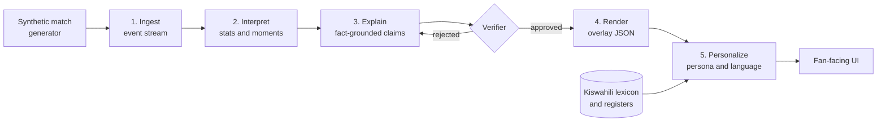

# Mechi Yako

> **One match, told your way, in your language.**

Mechi Yako ("your match" in Kiswahili) is an AI match-intelligence system. It takes a live stream of football match events and turns it into explainable insight that is personalized for each fan, and written **natively in Kiswahili**, not translated from English after the fact.

Built for the Microsoft Premier League Hackathon ("Inside the Game"). All data is **synthetic**, and all clubs and players are **fictional**.

<!-- TODO: add demo video link (under 2 minutes) -->
**Demo video:** _coming soon_ | **Live demo:** _coming soon_

---

## Current progress (handoff for Eric / Posh)

Owner split: see [`TEAM_TASKS.md`](TEAM_TASKS.md).  
**`main`** has the Oct 17 data/pipeline work. Latest explain/verify work is on **`feature/daniel-explain-verify`** (merge when ready).

### What Daniel shipped

| When | Piece | Where |
|---|---|---|
| Oct 17 | Event schema, demo match, fixtures, realism | `docs/`, `data/`, `generator/` |
| Oct 17 | Replay, state aggregator, moment detector | `pipeline/` |
| Oct 18 | **Claim schema** | [`docs/claim-schema.md`](docs/claim-schema.md) |
| Oct 18 | **Template explainer** (no Foundry yet) | [`agents/explainer.py`](agents/explainer.py) |
| Oct 18 | **Deterministic verifier** + audit log | [`agents/verifier.py`](agents/verifier.py) |
| Oct 18 | Explain→verify CLI + **injected wrong-stat** demo | `python -m agents.run_explain_verify` |

**Still for Eric:** `api/`, `web/`, `lexicon/`, personas, backend `tests/`.  
**Still for Daniel later:** Foundry-backed explainer, infra deploy, Why? panel / lower third.

### Storyline locked in the demo match

1. Blue Herons lead **1–0** at half time (~20′ goal).  
2. Red Kites **press** from ~**55′** and force turnovers in the Blue Herons half.  
3. Red Kites **equalise** ~**63′**.  
4. **RK-4** hits a **5th tackle won** milestone ~**78′**.

### Commands you can run today

```bash
git checkout feature/daniel-explain-verify   # or main after merge

python -m generator.build_demo_data
python -m pipeline.replay --instant
python -m pipeline.detect

# New: claims from fixtures → verify; wrong stat gets corrected/blocked
python -m agents.run_explain_verify
```

### Suggested next steps for Eric

1. Scaffold **`api/`** serving fixtures **and** (when merged) verified claims / audit log.  
2. Scaffold **`web/`** — moments feed + Why? panel hooks for verifier badges.  
3. Start **`lexicon/sw.yaml`** (demo-match terms).  
4. Only show **approved** (or auto-corrected) claims to personas / UI.

---

## The problem

1. **Broadcasts show what happened, not why it mattered.** A viewer sees a turnover and a shot. They don't see that it was the third time in five minutes the defence had been caught high.
2. **One broadcast serves everyone, so it serves no one well.** An analyst wants pressing numbers. A casual fan wants the story. A newcomer needs the terms explained.
3. **Most AI football tooling is English-first.** Machine-translated commentary is stiff, loses football idiom and mistranslates tactical terms. Millions of fans follow the game in Kiswahili, but the tooling around them rarely speaks it naturally.

## The solution

Mechi Yako sits on one shared layer of **verified facts** and renders it differently for every viewer:

- **One match, many matches.** The same moment is explained for an analyst, a casual fan, or a newcomer. The facts never change. The depth, vocabulary and focus do.
- **Kiswahili-first.** Narratives are generated directly in Kiswahili using a curated football lexicon and selectable registers (formal broadcast, casual banter, simple explainer).
- **Explainable by design.** Every on-screen claim cites the event IDs that support it, and a verifier blocks anything it cannot reproduce from the raw events.

### Same moment, three viewers

> Illustrative example using fictional clubs. Kiswahili text pending native-speaker review.

| Viewer | Output |
|---|---|
| **Analyst** (English) | 62' Blue Herons have lost possession four times in their own half in five minutes. Red Kites' press is forcing errors, with 7 high turnovers in the last 10 minutes. |
| **Casual fan** (English) | Blue Herons keep giving the ball away near their own goal, and Red Kites can smell a chance. |
| **Casual fan** (Kiswahili) | Dakika ya 62: Blue Herons wamepoteza mpira mara nne karibu na lango lao ndani ya dakika tano. Red Kites wanawabana vilivyo! |

Each line carries the event IDs it is based on, such as `e-0412`, `e-0415`, `e-0419`.

---

## How it works

Mechi Yako follows the five-stage pipeline in the hackathon brief.



1. **Ingest.** Synthetic events (passes, shots, tackles, possession changes, pressure) arrive on a stream with match metadata.
2. **Interpret.** Events are aggregated into match state and statistics, and a significance scorer picks out the moments that matter.
3. **Explain.** An explainer agent writes *why* each moment matters as structured claims, each tied to event IDs.
4. **Render.** Verified output is emitted as timed, machine-readable JSON that a graphics layer can place alongside a live feed.
5. **Personalize.** A persona agent rewrites the same verified facts for the chosen expertise level, language and register.

### Agents

| Agent | Role |
|---|---|
| **Moment Detector** | Scores events and picks out the moments worth explaining. |
| **Explainer** | Writes grounded, claim-structured explanations from a small event window. |
| **Verifier** | Recomputes every claim from raw events and approves, corrects or blocks it. |
| **Persona Writer** | Renders verified facts for a persona (analyst, casual fan, newcomer). |
| **Kiswahili Narrator** | Composes the narrative natively in Kiswahili using the lexicon and the selected register. |
| **Language QA** | Back-translates to English and checks the result against the fact layer. |

---

## Kiswahili-first, not translate-after

Most pipelines write in English and translate. Mechi Yako generates in the target language from structured facts.

- **Football lexicon.** A hand-built glossary of terms and idioms (`lexicon/sw.yaml`) is injected into prompts so terms are consistent.
- **Registers.** Formal broadcast, casual banter, and simple explainer.
- **Quality loop.** Output is back-translated and compared with the fact layer. Mismatches are flagged rather than shown.
- **Native review.** Lexicon entries and sample outputs are reviewed by a Kiswahili speaker before release. See [Known limitations](#known-limitations).

---

## Synthetic data

No real match data, footage, club names or player names are used.

The **Synthetic Match Factory** (`generator/`) produces football-realistic matches:

- Fictional clubs and players, with tactical profiles (for example high press or counter-attack).
- Possession-based simulation shaped by fatigue, momentum and score state.
- Seeded runs, so every match is reproducible.
- A **realism report** that checks each match against plausible ranges, such as pass completion, shots per match and possession spread.

Example event:

```json
{
  "id": "e-0415",
  "t": "62:14",
  "type": "tackle",
  "team": "RK",
  "player": "RK-4",
  "location": [68, 40],
  "outcome": "won_possession",
  "match_id": "m-0007"
}
```

The full schema is documented in [`docs/event-schema.md`](docs/event-schema.md).

---

## Trust and explainability

AI commentary is only useful on screen if it is right. Mechi Yako uses a **claim-then-verify** design:

1. The explainer emits text plus structured claims (metric, value, entities, event IDs).
2. The verifier recomputes each claim deterministically from the raw events.
3. Claims are approved, auto-corrected or blocked, and every decision is logged for audit.
4. Every persona and language version is checked against the same fact layer, so versions cannot drift apart.

---

## Tech stack

> Planned stack. Update as the build settles.

| Layer | Technology |
|---|---|
| Models and orchestration | Microsoft Foundry, Microsoft Agent Framework |
| Streaming | Azure Service Bus or Event Hubs |
| Compute | Azure Container Apps, Azure Functions |
| State and audit log | Azure Cosmos DB |
| Speech (optional) | Azure AI Speech |
| Observability | Application Insights, Foundry tracing |
| Front end | React + TypeScript (Vite) — planned |
| Local stream | In-process queue (`pipeline/queue.py`); Service Bus optional later |
| Dev tooling | GitHub Copilot Agent Mode |

---

## Getting started

Python 3.9+ is enough for the current libraries (no third-party deps required yet).

```bash
# 1. Clone
git clone https://github.com/posh9376/mechi-yako.git
cd mechi-yako
git checkout feature/daniel-explain-verify   # until merged to main

# 2. (Later) Azure / Foundry — not needed for template explainer or verifier
# cp .env.example .env

# 3. Demo data + realism
python -m generator.build_demo_data

# 4. Pipeline + explain/verify smoke
python -m pipeline.replay --instant
python -m pipeline.detect
python -m agents.run_explain_verify

# 5. API + UI — TODO (Eric)
```

### Project structure

```
mechi-yako/
├── data/           # Demo match JSON + fact-layer fixtures (Posh: consume these)
├── docs/           # Event schema + claim schema
├── generator/      # Scripted demo match builder + realism report
├── pipeline/       # Replay, state aggregator, moment detector (Daniel)
├── agents/         # Explainer + verifier (Daniel); persona/narrator soon — Eric
├── TEAM_TASKS.md   # Daniel vs Posh ownership
├── lexicon/        # (soon) Kiswahili lexicon — Eric
├── api/            # (soon) FastAPI — Eric
├── web/            # (soon) React UI — shared / alternate
├── infra/          # (later) Azure deploy — Daniel
└── tests/          # (soon) backend tests — Eric
```

---

## Status

- [x] Event schema defined (`docs/event-schema.md`)
- [x] Scripted demo match + realism report (`generator/`, `data/matches/`)
- [x] Fact-layer fixtures for API/UI stubs (`data/fixtures/`)
- [x] Replay / event stream library (`pipeline/replay.py`)
- [x] Match-state aggregator (`pipeline/state.py`)
- [x] Moment detection — deterministic (`pipeline/moments.py`)
- [x] Claim schema + template explainer + deterministic verifier (`agents/`, `docs/claim-schema.md`)
- [ ] Foundry-backed explainer (swap-in; schema unchanged)
- [ ] Persona engine (three personas)
- [ ] Kiswahili narration and lexicon
- [ ] Front end with persona and language switcher
- [ ] Deployed demo link
- [ ] Demo video

---

## Hackathon fit

| Hackathon requirement | Where Mechi Yako addresses it |
|---|---|
| Ingest, interpret, explain, render, personalize | The five-stage pipeline above |
| Explainability | Fact-grounded claims with event-ID citations and a verifier |
| Multi-language storytelling | Kiswahili-first native generation |
| Personalized experiences | Persona engine for analysts, casual fans and newcomers |
| Data innovation | Synthetic Match Factory with a realism report |
| Responsible, enterprise-ready AI | Verification, audit logging, fairness checks across versions |

---

## Responsible AI and data notes

- All data is synthetic. Clubs and players are fictional and no real marks or likenesses are used.
- Generated claims are verified against source events before display.
- Personas change framing and depth, never facts.
- This project is not affiliated with or endorsed by any league, club or broadcaster.

## Known limitations

- Kiswahili quality is limited to the lexicon and registers reviewed so far. Other languages and dialects are future work.
- Synthetic matches approximate real football. They are not a statistical model of any real league.
- `TODO`: add limitations as they are discovered.

## Roadmap

- More languages (Sheng, Arabic, Hindi) with native lexicons
- Audio narration in Kiswahili
- Player-focus mode
- Accessibility mode with audio description

## License

`TODO`: choose a license (MIT is a common default).

## Team

- **Daniel Githumbi** — data, pipeline libraries, infra/deploy; web slices (Why? panel / lower third).
- **Eric "Posh" Amenya**, Nairobi, Kenya — API, backend tests, personas, Kiswahili, demo video; web slices (match view / switches). Representative / submitter (default).
